<div align="center">

# 🧠 CIFAR-10 Image Classification using Deep Learning

### CNN from Scratch • Data Augmentation • Transfer Learning • Fine-Tuning • Residual Connections


<br>


<br>


<br>

> ### 🚀 A complete Deep Learning journey from basic convolution operations to CNNs, data augmentation, MobileNetV2 transfer learning, fine-tuning and residual connections.

</div>

---

# 📌 Project Overview

This project implements a complete **CIFAR-10 image classification pipeline** using **TensorFlow and Keras**.

The project begins with the fundamental concepts behind **Convolutional Neural Networks (CNNs)** and gradually progresses toward advanced deep-learning techniques including:

- 🔍 Manual convolution
- 🖼️ Padding and strides
- 🗺️ Feature-map visualization
- 📉 MaxPooling and AveragePooling
- 🏛️ LeNet-5
- 🧠 Custom CNN from scratch
- 🔄 CNN backpropagation concepts
- ⏹️ Early stopping
- 📉 Learning-rate reduction
- 🎨 Image augmentation
- 🧩 Keras augmentation layers
- ⚡ MobileNetV2 feature extraction
- 🔓 MobileNetV2 fine-tuning
- 🔗 Residual connections
- 📊 Six-model performance comparison

The final goal is to understand how different CNN architectures and training strategies affect image-classification performance.

---

# 🏆 Final Result

<div align="center">

## 🥇 Best Performing Model

# CNN Scratch + ImageDataGenerator

| 📊 Metric | 🏆 Result |
|:---|:---:|
| **Test Accuracy** | **84.61%** |
| Architecture | Custom CNN |
| Augmentation | ImageDataGenerator |
| Transfer Learning | No |
| Parameters | 175,018 |

<br>

# 🎯 84.61% Test Accuracy


</div>

The **Custom CNN trained with ImageDataGenerator augmentation** achieved the highest test accuracy among all six evaluated approaches.

---

# 📂 Dataset — CIFAR-10

The project uses the built-in **CIFAR-10 dataset** available through TensorFlow/Keras.

```python
from tensorflow.keras.datasets import cifar10

(X_train, y_train), (X_test, y_test) = cifar10.load_data()
```

## 📊 Dataset Information

| Property | Value |
|---|---:|
| 🖼️ Total Images | 60,000 |
| 🏋️ Training Images | 50,000 |
| 🧪 Test Images | 10,000 |
| 📐 Image Resolution | 32 × 32 |
| 🎨 Channels | 3 — RGB |
| 🏷️ Classes | 10 |
| 🔢 Original Pixel Range | 0–255 |
| ⚙️ Normalized Range | 0–1 |

---

# 🏷️ CIFAR-10 Classes

```text
0 → ✈️  Airplane
1 → 🚗 Automobile
2 → 🐦 Bird
3 → 🐱 Cat
4 → 🦌 Deer
5 → 🐶 Dog
6 → 🐸 Frog
7 → 🐴 Horse
8 → 🚢 Ship
9 → 🚚 Truck
```

CIFAR-10 contains small **32 × 32 RGB images**, making classification challenging.

Some classes are visually similar:

```text
🐱 Cat         ↔ 🐶 Dog

🚗 Automobile  ↔ 🚚 Truck
```

These similarities can produce classification errors, especially when the image contains a complex background or low-detail object.

---

# 🗂️ Repository Structure

```text
DL_PR4A_CIFAR10/
│
├── 📓 DL_PR4A.ipynb
├── 🌐 DL_PR4A.html
├── 📖 README.md
├── 📦 requirements.txt
│
├── 🧠 models/
│   └── cifar10_model.h5
│
└── 📊 plots/
    │
    ├── cifar10_samples_grid.png
    ├── pixel_histogram_before_normalization.png
    ├── pixel_histogram_after_normalization.png
    ├── manual_convolution_edge_detection.png
    ├── feature_map_original_image.png
    ├── feature_maps.png
    ├── feature_maps_before_pooling.png
    ├── maxpooling_feature_maps.png
    ├── averagepooling_feature_maps.png
    ├── training_curves.png
    ├── confusion_matrix.png
    ├── misclassified_images.png
    ├── original_image_before_augmentation.png
    ├── augmentation_grid.png
    ├── augmentation_validation_comparison.png
    ├── augmentation_accuracy_comparison.png
    ├── keras_augmentation_grid.png
    ├── transfer_learning_curves.png
    └── results_table.png
```

---

# 🔄 Complete Project Workflow

```text
                        CIFAR-10
                           │
                           ▼
                  Data Exploration
                           │
                           ▼
                     Preprocessing
                           │
              ┌────────────┴────────────┐
              ▼                         ▼
         Normalization            One-Hot Encoding
              │                         │
              └────────────┬────────────┘
                           ▼
                    CNN Fundamentals
                           │
           ┌───────────────┼───────────────┐
           ▼               ▼               ▼
      Convolution       Padding          Strides
           │
           ▼
      Feature Maps
           │
           ▼
        Pooling
           │
      ┌────┴─────┐
      ▼          ▼
 MaxPooling  AveragePooling
      │
      └────┬─────┘
           ▼
        LeNet-5
           │
           ▼
      Custom CNN
           │
           ▼
        Training
           │
           ▼
       Evaluation
           │
     ┌─────┴────────────────┐
     ▼                      ▼
Data Augmentation      Transfer Learning
     │                      │
 ┌───┴────┐                 ▼
 ▼        ▼             MobileNetV2
Image   Keras                │
Gen     Layers        ┌──────┴──────┐
 │         │          ▼             ▼
 └────┬────┘       Feature       Fine-
      │          Extraction      Tuning
      │              │             │
      └──────────────┴──────┬──────┘
                            ▼
                    Model Comparison
                            │
                            ▼
                    🏆 Best Model
                            │
                            ▼
              CNN + ImageDataGenerator
                            │
                            ▼
                         84.61%
```

---

# 1️⃣ Data Exploration & Preprocessing

The first stage focuses on preparing CIFAR-10 for deep-learning models.

### Operations Performed

```text
CIFAR-10
   │
   ├── Dataset Shape
   ├── Data Types
   ├── Unique Labels
   ├── Sample Visualization
   ├── Pixel Distribution
   ├── Normalization
   └── One-Hot Encoding
```

## 🔢 Normalization

Original image values:

```text
0 ────────────────────────────── 255
```

After normalization:

```text
0.0 ──────────────────────────── 1.0
```

Implemented using:

```python
X_train = X_train.astype("float32") / 255.0
X_test = X_test.astype("float32") / 255.0
```

Normalization provides a consistent numerical scale for neural-network optimization.

---

# 🖼️ CIFAR-10 Samples

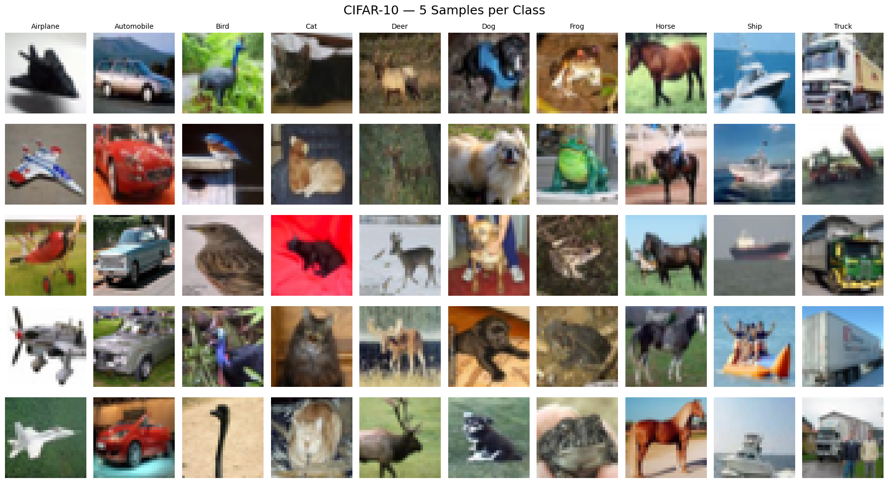

The visualization displays examples from all ten CIFAR-10 classes.

---

# 📊 Pixel Distribution

### Before Normalization

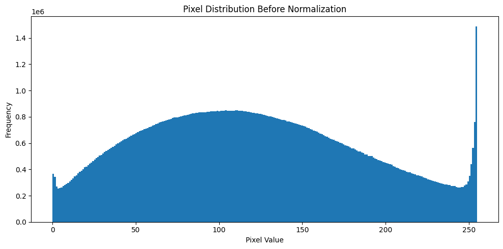

### After Normalization

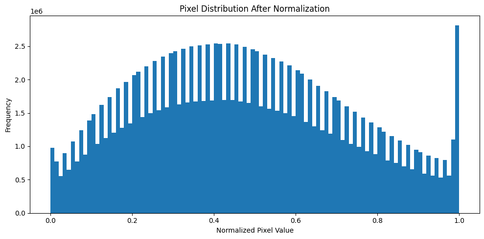

---

# 🧠 CNN vs ANN

A traditional fully connected neural network generally requires an image to be flattened.

```text
          IMAGE
       32 × 32 × 3
            │
            ▼
         Flatten
            │
            ▼
       3072 Values
            │
            ▼
        Dense Layer
```

Flattening removes explicit spatial relationships between nearby pixels.

A CNN instead uses local learnable filters:

```text
           IMAGE
             │
             ▼
        3 × 3 Kernel
             │
             ▼
      Local Convolution
             │
             ▼
        Feature Map
```

### Why CNNs are suitable for images

- 🔍 Local feature extraction
- ♻️ Parameter sharing
- 🗺️ Preservation of spatial information
- 📉 Fewer parameters than large fully connected networks
- 🧠 Hierarchical feature learning

---

# 2️⃣ Manual Convolution

A manual convolution operation was implemented using an edge-detection kernel.

```python
kernel = np.array([
    [-1, -1, -1],
    [-1,  8, -1],
    [-1, -1, -1]
])
```

The kernel moves across the image and performs a local dot product.

```text
Image Patch
    ×
3 × 3 Kernel
    │
    ▼
Dot Product
    │
    ▼
One Feature-Map Value
```

## 🔍 Edge Detection Result

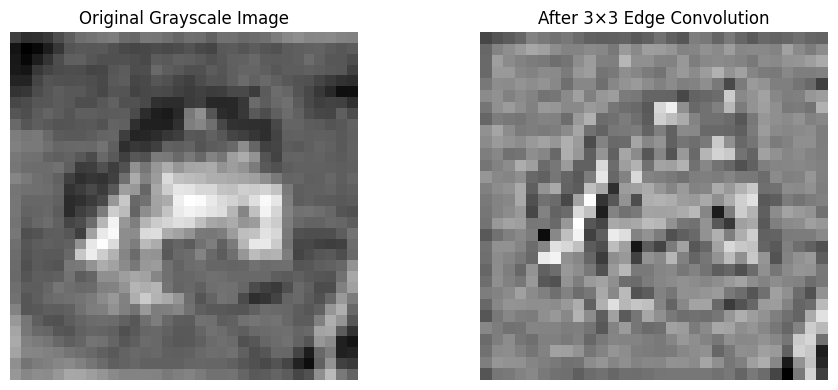

This demonstrates the fundamental mathematical operation performed by a CNN's `Conv2D` layer.

---

# 3️⃣ Padding

Two padding strategies were investigated.

## VALID Padding

```text
Input
32 × 32
   │
   │ 3×3 Kernel
   ▼
30 × 30
Output
```

No additional pixels are added around the input.

## SAME Padding

```text
       Zero Padding
     ┌──────────────┐
     │   32 × 32    │
     │    Image     │
     └──────────────┘
            │
            ▼
        3×3 Kernel
            │
            ▼
         32 × 32
```

`SAME` padding helps preserve spatial dimensions.

---

# 4️⃣ Strides

Stride determines how many pixels the filter moves after each convolution.

```text
Stride = 1
32 × 32
   │
   ▼
32 × 32

Stride = 2
32 × 32
   │
   ▼
16 × 16
```

Larger strides reduce spatial dimensions and computational requirements.

---

# 5️⃣ Feature Maps

A convolution layer containing **16 filters** was used.

```python
layers.Conv2D(
    16,
    (3, 3),
    activation="relu",
    padding="same"
)
```

Input:

```text
(1, 32, 32, 3)
```

Output:

```text
(1, 32, 32, 16)
```

Each filter generates a different feature map.

## 🗺️ Feature-Map Visualization

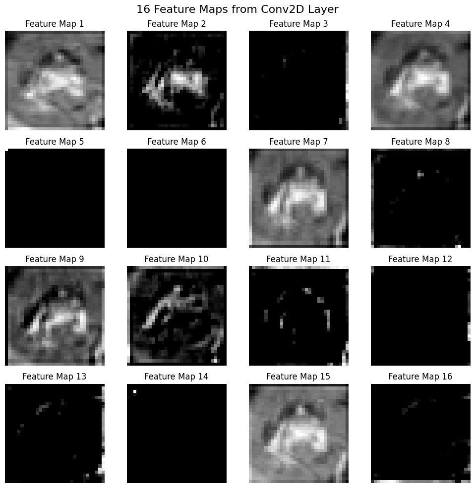

Early CNN filters can respond to:

```text
Edges
  │
  ▼
Lines
  │
  ▼
Textures
  │
  ▼
Shapes
  │
  ▼
Complex Visual Features
```

---

# 6️⃣ Pooling Operations

Pooling reduces the spatial size of feature maps.

## 🔵 Before Pooling

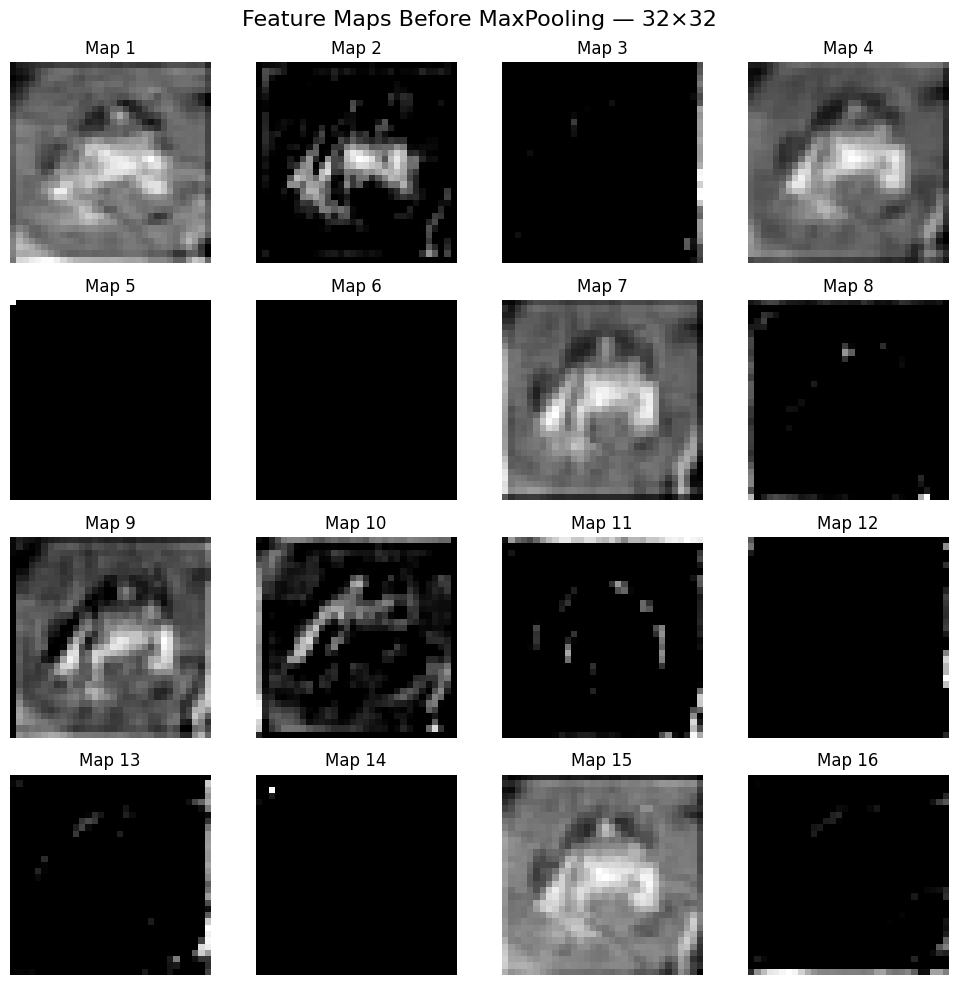

## 🔥 MaxPooling

```text
┌─────────┐
│ 1  8    │
│ 4  3    │
└─────────┘
     │
     ▼
     8
```

MaxPooling retains the strongest activation.

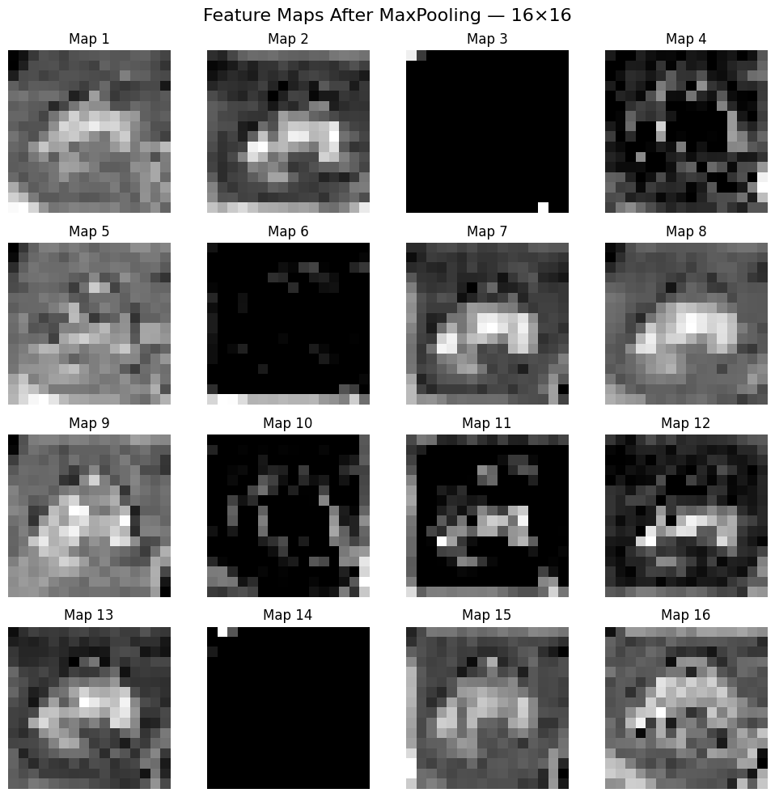

## 🌊 AveragePooling

```text
┌─────────┐
│ 1  8    │
│ 4  3    │
└─────────┘
     │
     ▼
    4.0
```

AveragePooling keeps the average activation.

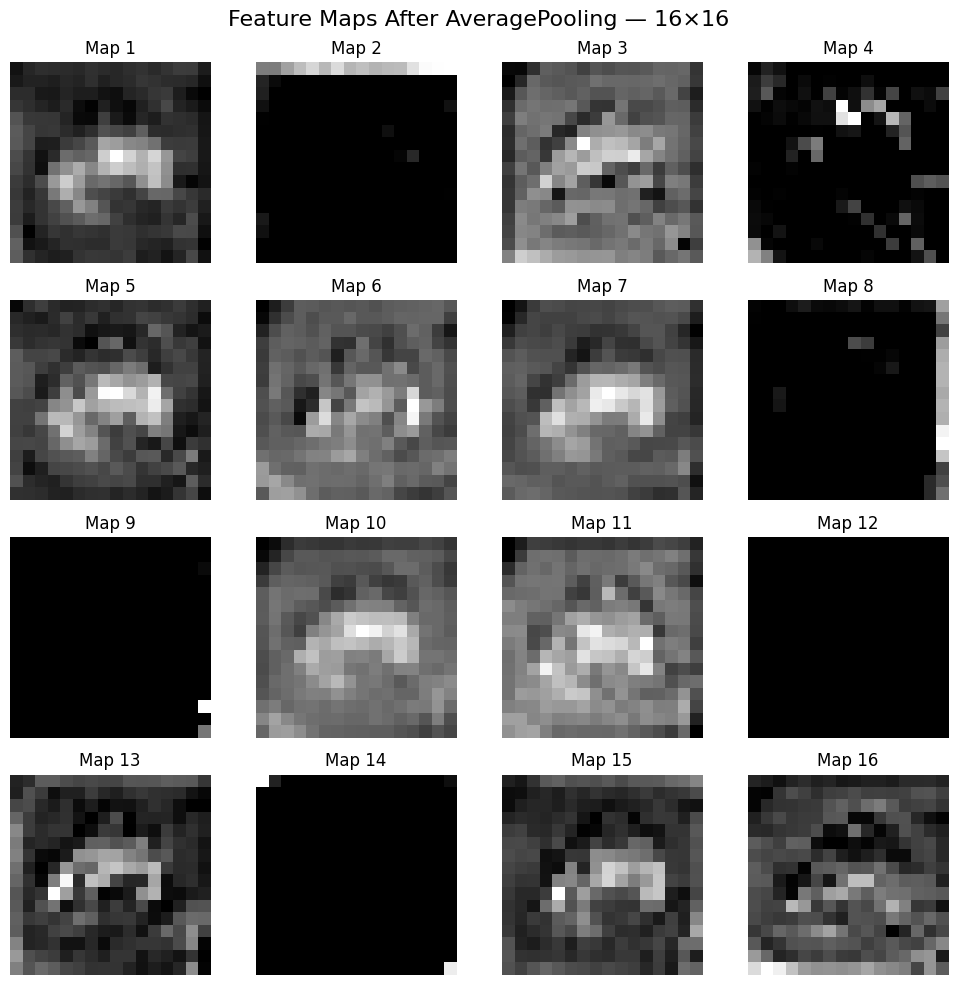

---

# 7️⃣ LeNet-5

The historical **LeNet-5 architecture** was adapted for CIFAR-10.

```text
Input
32 × 32 × 3
      │
      ▼
Conv2D
6 × 5×5
Tanh
      │
      ▼
AveragePooling
      │
      ▼
Conv2D
16 × 5×5
Tanh
      │
      ▼
AveragePooling
      │
      ▼
Flatten
      │
      ▼
Dense 120
Tanh
      │
      ▼
Dense 84
Tanh
      │
      ▼
Dense 10
Softmax
```

## Parameter Calculation

First convolution:

```text
(5 × 5 × 3 + 1) × 6
= 456
```

Second convolution:

```text
(5 × 5 × 6 + 1) × 16
= 2,416
```

### Final LeNet-5 Result

```text
Parameters    : 62,006
Test Accuracy : 53.45%
```

---

# 8️⃣ Custom CNN Architecture

A modern CNN architecture was built from scratch.

```text
Input
32 × 32 × 3
      │
      ▼
┌────────────────────┐
│ Conv2D 32 — 3×3    │
│ ReLU + SAME        │
└────────────────────┘
      │
      ▼
┌────────────────────┐
│ Conv2D 32 — 3×3    │
│ ReLU + SAME        │
└────────────────────┘
      │
      ▼
 MaxPooling2D
      │
      ▼
┌────────────────────┐
│ Conv2D 64 — 3×3    │
│ ReLU + SAME        │
└────────────────────┘
      │
      ▼
┌────────────────────┐
│ Conv2D 64 — 3×3    │
│ ReLU + SAME        │
└────────────────────┘
      │
      ▼
 MaxPooling2D
      │
      ▼
 Conv2D 128
      │
      ▼
GlobalAveragePooling
      │
      ▼
 Dense 256 + ReLU
      │
      ▼
 Dense 10 + Softmax
      │
      ▼
Prediction
```

### Total Parameters

```text
175,018
```

### Test Accuracy Without Augmentation

```text
80.33%
```

---

# 9️⃣ CNN Training

The custom CNN was compiled with:

```python
model_cnn.compile(
    optimizer="adam",
    loss="categorical_crossentropy",
    metrics=["accuracy"]
)
```

Training configuration:

| Setting | Value |
|---|---|
| Maximum Epochs | 100 |
| Batch Size | 64 |
| Validation Split | 10% |
| Optimizer | Adam |
| Loss | Categorical Crossentropy |
| Early Stopping | Yes |
| LR Reduction | Yes |

---

# ⏹️ EarlyStopping

```python
EarlyStopping(
    monitor="val_loss",
    patience=10,
    restore_best_weights=True
)
```

This restores the weights from the best validation-loss epoch.

---

# 📉 ReduceLROnPlateau

```python
ReduceLROnPlateau(
    monitor="val_loss",
    factor=0.5,
    patience=5,
    min_lr=1e-6
)
```

When validation loss stops improving, the learning rate is reduced.

---

# 📈 CNN Training Curves

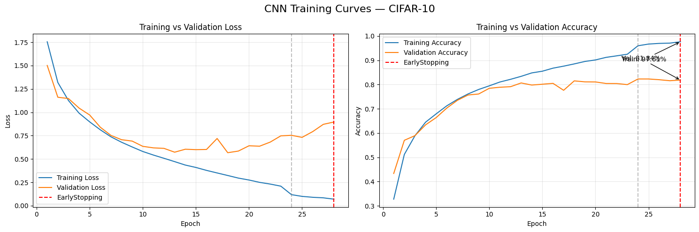

Training curves make it easier to analyze:

- Training loss
- Validation loss
- Training accuracy
- Validation accuracy
- Convergence
- Potential overfitting

---

# 🔟 Model Evaluation

The trained CNN was evaluated against the unseen CIFAR-10 test set.

The evaluation includes:

- Test accuracy
- Test loss
- Confusion matrix
- Confused class pairs
- Misclassified samples

---

# 🧩 Confusion Matrix

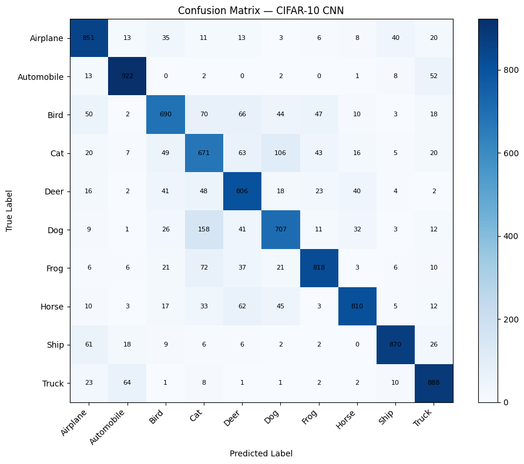

The confusion matrix helps identify which classes are classified correctly and which classes are commonly confused.

---

# ❌ Misclassified Images

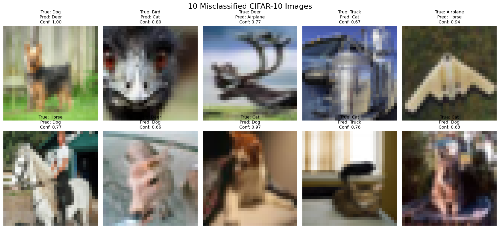

Possible reasons for incorrect classifications include:

```text
Low Resolution
      │
      ├── Similar Objects
      ├── Complex Backgrounds
      ├── Object Orientation
      ├── Partial Objects
      └── Limited Visual Details
```

---

# 1️⃣1️⃣ Data Augmentation

Data augmentation was applied to increase training-data diversity.

```python
ImageDataGenerator(
    rotation_range=15,
    width_shift_range=0.1,
    height_shift_range=0.1,
    horizontal_flip=True,
    zoom_range=0.1,
    fill_mode="nearest"
)
```

## 🎨 Augmentation Operations

```text
             Original Image
                   │
        ┌──────────┼───────────┐
        │          │           │
        ▼          ▼           ▼
    Rotation     Shift        Zoom
        │          │           │
        └──────────┼───────────┘
                   ▼
            Horizontal Flip
                   │
                   ▼
            Augmented Images
```

## 🖼️ Augmentation Grid

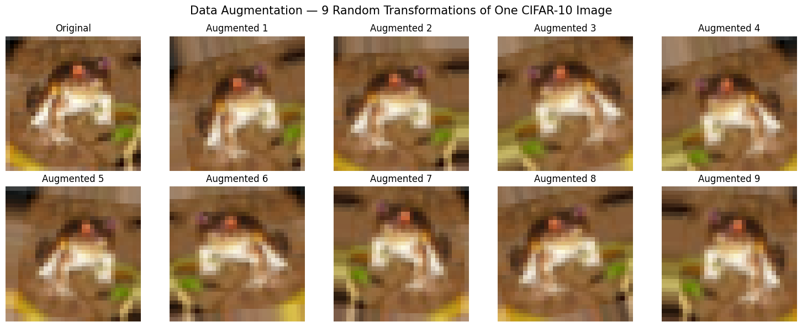

---

# 🚀 Impact of Data Augmentation

Without augmentation:

```text
CNN Scratch
Test Accuracy = 80.33%
```

With `ImageDataGenerator`:

```text
CNN Scratch + Aug
Test Accuracy = 84.61%
```

### 📈 Improvement

```text
84.61% - 80.33%
        =
   +4.28 percentage points
```

<div align="center">

### 🔥 Data Augmentation improved the custom CNN from **80.33% → 84.61%**


</div>

---

# 📊 Augmentation Comparison

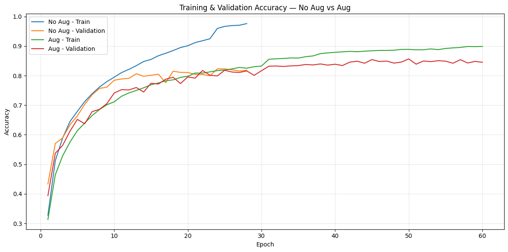

This experiment demonstrates how augmentation can improve generalization by exposing the CNN to transformed versions of training images.

---

# 1️⃣2️⃣ Keras Augmentation Layers

A second augmentation pipeline was created directly inside the neural network.

```python
data_augmentation = keras.Sequential([
    layers.RandomFlip("horizontal"),
    layers.RandomRotation(0.1),
    layers.RandomZoom(0.1),
    layers.RandomTranslation(0.1, 0.1)
])
```

## Visualization

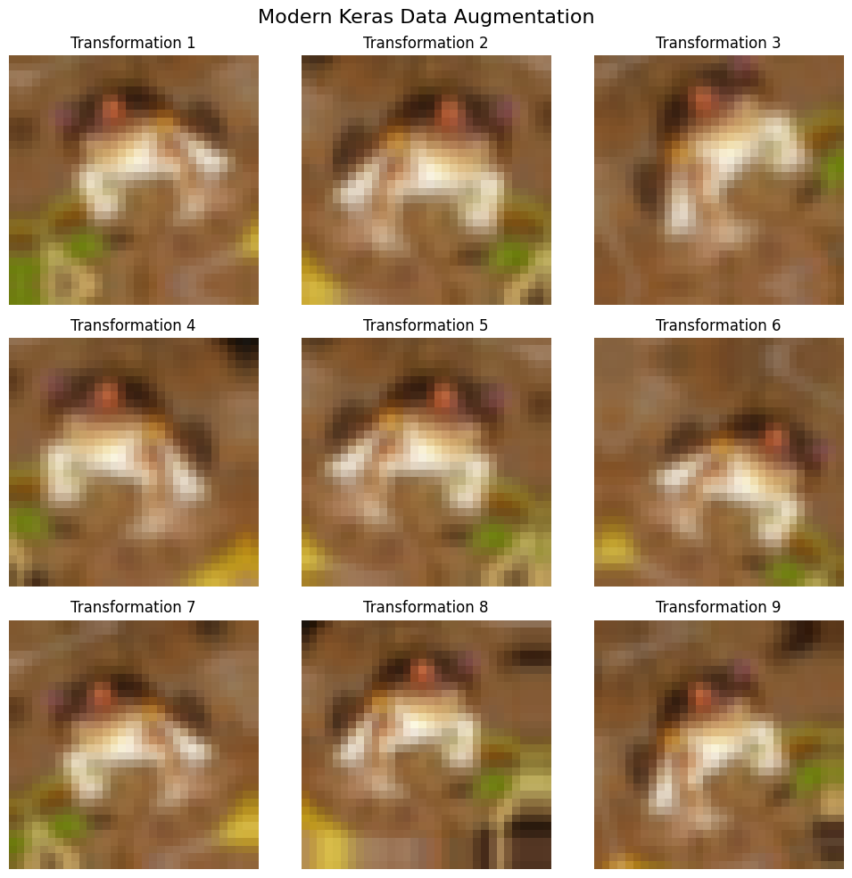

### Final Result

```text
Architecture    : Custom CNN
Augmentation    : Keras Layers
Test Accuracy   : 79.89%
Parameters      : 175,018
```

In this experiment, `ImageDataGenerator` produced better test performance than the Keras augmentation-layer configuration.

---

# 1️⃣3️⃣ Transfer Learning

The project next explores transfer learning using **MobileNetV2**.

```text
               MobileNetV2
                    │
        Pre-trained Knowledge
                    │
             ┌──────┴──────┐
             ▼             ▼
          Frozen        Unfrozen
             │             │
             ▼             ▼
          Feature         Fine-
         Extraction       Tuning
```

---

# ⚡ MobileNetV2 Feature Extraction

The MobileNetV2 base was initially frozen.

```python
base_model.trainable = False
```

Architecture:

```text
Input
  │
  ▼
MobileNetV2
(Frozen)
  │
  ▼
GlobalAveragePooling2D
  │
  ▼
Dense 128 + ReLU
  │
  ▼
Dense 10 + Softmax
```

### Result

```text
Test Accuracy : 79.41%
Parameters    : 2,423,242
```

---

# 🔓 MobileNetV2 Fine-Tuning

After feature extraction, the top MobileNetV2 layers were made trainable.

A small learning rate was used:

```python
Adam(learning_rate=1e-5)
```

This allows the pre-trained features to adapt gradually to CIFAR-10.

### Result

```text
Test Accuracy : 80.83%
Parameters    : 2,423,242
```

### Fine-Tuning Improvement

```text
80.83% - 79.41%
        =
   +1.42 percentage points
```

---

# 📈 Transfer Learning Training Curves


The graph shows the transition from:

```text
Feature Extraction
        │
        ▼
Fine-Tuning Begins
        │
        ▼
Fine-Tuned Model
```

---

# 1️⃣4️⃣ Residual Connection

A basic residual block was also implemented.

```text
                          ┌───────────────┐
                          │ Conv2D 1 × 1  │
                          │   Shortcut    │
                          └───────┬───────┘
                                  │
Input ────────────────────────────┼─────────┐
  │                                         │
  ▼                                         │
Conv2D 3×3                                  │
  │                                         │
 ReLU                                       │
  │                                         │
  ▼                                         │
Conv2D 3×3                                  │
  │                                         │
  └───────────────────┬─────────────────────┘
                      ▼
                     Add
                      │
                      ▼
                    ReLU
                      │
                      ▼
                   Output
```

Residual connections create shortcut paths for information and gradients.

They are particularly useful when training deeper networks.

---

# 📊 FINAL MODEL COMPARISON

<div align="center">

## 🏆 Six Deep Learning Approaches Compared

</div>

| Rank | Model | Architecture | Augmentation | Transfer Learning | Test Accuracy | Parameters |
|:---:|---|---|---|---|---:|---:|
| 🥇 | **CNN Scratch + Aug** | **Custom CNN** | **ImageDataGenerator** | **No** | **84.61%** 🏆 | **175,018** |
| 🥈 | **MobileNetV2 Fine-Tuned** | MobileNetV2 | No | Fine-Tuning | **80.83%** | 2,423,242 |
| 🥉 | **CNN Scratch No Aug** | Custom CNN | No | No | **80.33%** | 175,018 |
| 4 | CNN + Keras Aug Layers | Custom CNN | Keras Layers | No | **79.89%** | 175,018 |
| 5 | MobileNetV2 Feature Extraction | MobileNetV2 | No | Feature Extraction | **79.41%** | 2,423,242 |
| 6 | LeNet-5 | LeNet-5 | No | No | **53.45%** | 62,006 |

---

# 🖼️ Final Results Table


---

# 🏆 Performance Ranking

```text
🥇 CNN Scratch + ImageDataGenerator      84.61%  ██████████████████████████████████████████

🥈 MobileNetV2 Fine-Tuned                80.83%  ████████████████████████████████████████

🥉 CNN Scratch No Aug                    80.33%  ████████████████████████████████████████

④  CNN + Keras Aug Layers               79.89%  ███████████████████████████████████████

⑤  MobileNetV2 Feature Extraction       79.41%  ███████████████████████████████████████

⑥  LeNet-5                              53.45%  ██████████████████████████
```

---

# 🔬 Key Experimental Findings

## 🥇 Best Model

```text
CNN Scratch + ImageDataGenerator
```

achieved:

# **84.61%**

test accuracy.

---

## 🎨 Data Augmentation Helped

```text
CNN Scratch No Aug     : 80.33%
CNN Scratch + Aug      : 84.61%
--------------------------------
Improvement            : +4.28 percentage points
```

This is one of the most important findings of the project.

---

## 🔓 Fine-Tuning Helped MobileNetV2

```text
Feature Extraction : 79.41%
Fine-Tuned         : 80.83%
----------------------------
Improvement        : +1.42 percentage points
```

Fine-tuning improved the transfer-learning model.

---

## ⚡ Custom CNN vs MobileNetV2

```text
Custom CNN + Aug
Accuracy   : 84.61%
Parameters : 175,018

              VS

MobileNetV2 Fine-Tuned
Accuracy   : 80.83%
Parameters : 2,423,242
```

The custom augmented CNN achieved **3.78 percentage points higher test accuracy** in this experiment while using far fewer parameters.

---

# 📐 Parameter Comparison

| Model | Parameters | Test Accuracy |
|---|---:|---:|
| LeNet-5 | 62,006 | 53.45% |
| Custom CNN | 175,018 | 80.33% |
| Custom CNN + ImageDataGenerator | 175,018 | **84.61% 🏆** |
| Custom CNN + Keras Aug | 175,018 | 79.89% |
| MobileNetV2 Feature Extraction | 2,423,242 | 79.41% |
| MobileNetV2 Fine-Tuned | 2,423,242 | 80.83% |

---

# 💡 Accuracy vs Model Size

The experiment produced an interesting result:

```text
Custom CNN + Aug
│
├── Parameters → 175,018
└── Accuracy   → 84.61% 🏆


MobileNetV2 Fine-Tuned
│
├── Parameters → 2,423,242
└── Accuracy   → 80.83%
```

For this particular experiment, the smaller custom CNN combined with data augmentation achieved the strongest final test performance.

---

# 🛠️ Technologies Used

<div align="center">

| Technology | Purpose |
|:---:|---|
| 🐍 **Python** | Main Programming Language |
| 🧠 **TensorFlow** | Deep Learning Framework |
| 🔥 **Keras** | CNN Development |
| 🔢 **NumPy** | Numerical Computation |
| 📊 **Pandas** | Results & Tables |
| 📈 **Matplotlib** | Data Visualization |
| 🧮 **SciPy** | Manual Convolution |
| 🤖 **Scikit-learn** | Evaluation |
| 📓 **Jupyter Notebook** | Development Environment |
| 🐙 **GitHub** | Project Repository |

</div>

---

# 📦 Installation

## 1. Clone Repository

```bash
git clone YOUR_REPOSITORY_URL
```

## 2. Enter Project Folder

```bash
cd DL_PR4A_CIFAR10
```

## 3. Install Requirements

```bash
pip install -r requirements.txt
```

## 4. Start Jupyter Notebook

```bash
jupyter notebook
```

## 5. Open

```text
DL_PR4A.ipynb
```

Then run:

```text
Kernel
   ↓
Restart Kernel and Run All Cells
```

---

# 📋 requirements.txt

```text
tensorflow
numpy
pandas
matplotlib
scipy
scikit-learn
jupyter
```

---

# ▶️ How to Run

```bash
# Clone repository
git clone YOUR_REPOSITORY_URL

# Enter project
cd DL_PR4A_CIFAR10

# Install dependencies
pip install -r requirements.txt

# Start Jupyter
jupyter notebook
```

Then open:

```text
DL_PR4A.ipynb
```

The CIFAR-10 dataset is automatically downloaded through TensorFlow/Keras.

---

# 🎥 Project Demo Video

<div align="center">

## 🎬 Watch Complete Project Demonstration

[](YOUR_VIDEO_LINK)

<br>

**CNN • CIFAR-10 • Augmentation • MobileNetV2 • Fine-Tuning**

</div>

> 🔗 Replace `YOUR_VIDEO_LINK` with your actual project demonstration video URL.

---

# 📸 Project Visualizations

| Visualization | Description |
|---|---|
| 🖼️ CIFAR-10 Grid | Samples from all classes |
| 📊 Pixel Histograms | Before & after normalization |
| 🔍 Manual Convolution | Edge detection |
| 🗺️ Feature Maps | Learned convolution features |
| 🔥 MaxPooling | Max-pooled feature maps |
| 🌊 AveragePooling | Average-pooled feature maps |
| 📈 Training Curves | CNN learning behavior |
| 🧩 Confusion Matrix | Class-level evaluation |
| ❌ Misclassified Images | Error analysis |
| 🎨 Augmentation Grid | ImageDataGenerator transformations |
| 🧩 Keras Augmentation | Modern augmentation layers |
| ⚡ Transfer Curves | Feature extraction + fine-tuning |
| 🏆 Results Table | Six-model comparison |

---

# 🧠 Concepts Covered

```text
DEEP LEARNING
│
├── 📊 Data Preprocessing
│   ├── Normalization
│   └── One-Hot Encoding
│
├── 🧠 CNN Fundamentals
│   ├── Convolution
│   ├── Kernels
│   ├── Padding
│   ├── Strides
│   └── Feature Maps
│
├── 📉 Pooling
│   ├── MaxPooling
│   ├── AveragePooling
│   └── GlobalAveragePooling
│
├── 🏛️ CNN Architectures
│   ├── LeNet-5
│   └── Custom CNN
│
├── 🔄 Training
│   ├── Backpropagation
│   ├── Adam
│   ├── Categorical Crossentropy
│   ├── EarlyStopping
│   └── ReduceLROnPlateau
│
├── 🎨 Data Augmentation
│   ├── ImageDataGenerator
│   └── Keras Augmentation Layers
│
├── ⚡ Transfer Learning
│   └── MobileNetV2
│       ├── Feature Extraction
│       └── Fine-Tuning
│
└── 🔗 Modern CNN Concepts
    └── Residual Connections
```

---

# 🎯 Project Highlights

<div align="center">

| 🚀 Highlight | 📊 Result |
|:---|:---:|
| Dataset | CIFAR-10 |
| Total Images | 60,000 |
| Classes | 10 |
| Models Compared | 6 |
| Best Architecture | Custom CNN |
| Best Augmentation | ImageDataGenerator |
| 🏆 Best Accuracy | **84.61%** |
| Best Model Parameters | **175,018** |
| Transfer Model | MobileNetV2 |
| Fine-Tuned Accuracy | **80.83%** |
| Framework | TensorFlow / Keras |

</div>

---

# 📚 What I Learned

Through this project, I gained practical experience in:

- ✅ Loading and exploring image datasets
- ✅ Image normalization
- ✅ One-hot encoding
- ✅ Manual convolution
- ✅ CNN filters and kernels
- ✅ Padding and strides
- ✅ Feature-map visualization
- ✅ MaxPooling and AveragePooling
- ✅ Building LeNet-5
- ✅ Building CNNs from scratch
- ✅ CNN backpropagation concepts
- ✅ Training with callbacks
- ✅ Early stopping
- ✅ Learning-rate reduction
- ✅ Confusion-matrix analysis
- ✅ Misclassification analysis
- ✅ Image augmentation
- ✅ Keras augmentation layers
- ✅ Transfer learning
- ✅ Feature extraction
- ✅ Fine-tuning
- ✅ MobileNetV2
- ✅ Residual connections
- ✅ Comparing deep-learning models

---

# 🔮 Future Improvements

The project can be extended using:

```text
Current Project
      │
      ├── Batch Normalization
      │
      ├── Dropout
      │
      ├── Advanced Augmentation
      │
      ├── Hyperparameter Tuning
      │
      ├── Learning Rate Scheduling
      │
      ├── ResNet
      │
      ├── EfficientNet
      │
      ├── Grad-CAM
      │
      ├── Model Ensemble
      │
      └── Web Deployment
```

Possible future work includes experimenting with deeper architectures and more advanced regularization while maintaining good generalization.

---

# 📌 Final Conclusion

This project demonstrates the complete development of a **CIFAR-10 image-classification system**, beginning with fundamental convolution concepts and progressing toward modern deep-learning techniques.

Six different approaches were evaluated:

```text
1. LeNet-5
2. CNN Scratch No Augmentation
3. CNN Scratch + ImageDataGenerator
4. CNN + Keras Augmentation Layers
5. MobileNetV2 Feature Extraction
6. MobileNetV2 Fine-Tuning
```

The final experiment showed that the best-performing approach was:

<div align="center">

# 🥇 CNN Scratch + ImageDataGenerator

# 🏆 84.61%

### Test Accuracy


</div>

Data augmentation improved the custom CNN from **80.33% to 84.61%**, representing an improvement of **4.28 percentage points**.

Fine-tuning also improved MobileNetV2 from **79.41% to 80.83%**, an improvement of **1.42 percentage points**.

The experiment demonstrates that a larger pre-trained model does not automatically guarantee the highest test accuracy for every dataset and training setup. In this project, the relatively compact custom CNN combined with `ImageDataGenerator` achieved the strongest final result.

---

<div align="center">

# 👨‍💻 Author

## Tushar Vala

### Data Analyst | AI/ML Developer

<br>


<br>

---

### ⭐ If you found this project useful, consider giving the repository a star!

### 🚀 From CNN Fundamentals to Transfer Learning

**CIFAR-10 • CNN • Data Augmentation • MobileNetV2 • Fine-Tuning • Residual Connections**

<br>


</div>
